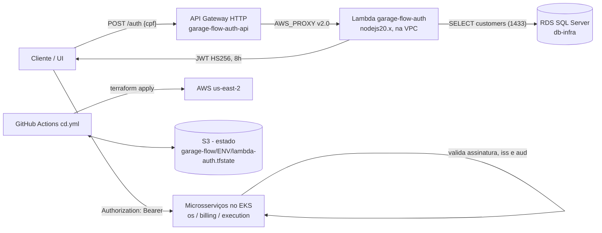

# fiap-garageflow-lambda-auth

Função **AWS Lambda (Node.js 20)** que autentica clientes do GarageFlow por **CPF** e emite um **JWT**, exposta por um **API Gateway HTTP** (`POST /auth`). Todo o provisionamento (IAM, Lambda, API Gateway) é feito com Terraform e publicado por GitHub Actions.

Projeto do Tech Challenge Fase 4 (FIAP Pós Tech): a oficina mecânica, antes um monólito, foi refatorada em microsserviços (`os`, `billing`, `execution`) executados no EKS, na AWS (`us-east-2`), com deploy via GitHub Actions + Terraform.

## Sumário

- [Visão geral da solução](#visão-geral-da-solução)
- [Fluxo de autenticação (CPF + JWT)](#fluxo-de-autenticação-cpf--jwt)
- [O que este repositório provisiona](#o-que-este-repositório-provisiona)
- [Variáveis do Terraform](#variáveis-do-terraform)
- [Outputs](#outputs)
- [Estado remoto (S3)](#estado-remoto-s3)
- [Pipelines](#pipelines)
- [Como executar](#como-executar)
- [Dependências e ordem de deploy](#dependências-e-ordem-de-deploy)
- [Segurança](#segurança)
- [Custos e limpeza](#custos-e-limpeza)
- [Troubleshooting](#troubleshooting)
- [Status e pendências](#status-e-pendências)

## Visão geral da solução



### Repositórios da solução

Todos em `https://github.com/FiapPosEAA/<repo>`.

| Repositório | Papel |
|---|---|
| `fiap-garageflow-api` | Monólito legado (.NET); contém a documentação de arquitetura e o ADR 0001 |
| `fiap-garageflow-db-infra` | RDS SQL Server (instância única, bancos `garageflow-os` e `garageflow-billing`) e rede |
| `fiap-garageflow-k8s-infra` | EKS, rede do cluster e IAM dos nodes |
| `fiap-garageflow-lambda-auth` | **Este repo** - Lambda de autenticação por CPF + JWT e API Gateway |
| `garageflow-os-service` | Microsserviço de ordens de serviço; provisiona as filas SQS (workflow `Provision SQS`) |
| `garageflow-billing-service` | Microsserviço de faturamento |
| `garageflow-execution-service` | Microsserviço de execução; provisiona a tabela DynamoDB (workflow `Provision DynamoDB`) |
| `garageflow-ui` | Front-end |

## Fluxo de autenticação (CPF + JWT)

Implementado em [index.js](index.js) (`exports.handler`):

1. Lê o corpo: se `event.body` é string, faz `JSON.parse`; caso contrário usa o próprio `event` (invocação direta). O CPF vem de `cpf` ou `document`.
2. Normaliza (remove tudo que não é dígito) e valida: 11 dígitos, não todos iguais, dois dígitos verificadores corretos. Falha -> **401** `CPF inválido.`
3. Conecta ao SQL Server (pacote `mssql`, timeouts de 60 s) com `DB_HOST`, `DB_PORT` (padrão 1433), `DB_NAME`, `DB_USER`, `DB_PASSWORD`; `encrypt` ligado a menos que `DB_ENCRYPT=false`; `trustServerCertificate` só se `DB_TRUST_SERVER_CERTIFICATE=true`.
4. Executa `SELECT TOP 1 id, name, document, isActive FROM customers WHERE document = @document` (consulta parametrizada). Sem resultado -> **401** `Cliente não encontrado.`
5. Se `isActive === false` -> **401** `Cliente inativo.`
6. Assina o JWT (`jsonwebtoken`, HS256 padrão) com `JWT_SECRET`, validade **8 h**, `issuer = JWT_ISSUER` (padrão `GarageFlowService`) e os claims `sub` (id), `name`, `document` e `role = "Customer"`. **Não define `aud` (audience).**
7. Responde **200** com o token já prefixado por `Bearer `.

Qualquer exceção -> **500** com `{ "error": <mensagem da exceção> }`.

### Exemplo de requisição

```bash
curl -X POST "<api_gateway_url>/auth" \
  -H "Content-Type: application/json" \
  -d '{"cpf":"123.456.789-09"}'
```

### Respostas

Sucesso (`200`):

```json
{
  "token": "Bearer <jwt>",
  "expiresAt": "2026-01-01T20:00:00.000Z",
  "customer": {
    "id": "<id-do-cliente>",
    "name": "Nome do Cliente",
    "document": "12345678909"
  }
}
```

Erros:

| Situação | Status | Corpo |
|---|---|---|
| CPF ausente/ inválido | 401 | `{"error":"CPF inválido."}` |
| CPF não cadastrado | 401 | `{"error":"Cliente não encontrado."}` |
| Cliente com `isActive = false` | 401 | `{"error":"Cliente inativo."}` |
| Falha de banco, JWT ou outra exceção | 500 | `{"error":"<mensagem>"}` |

Payload do JWT (campos nomeados conforme o código; valores ilustrativos):

```json
{
  "sub": "<id-do-cliente>",
  "name": "Nome do Cliente",
  "document": "12345678909",
  "role": "Customer",
  "iat": 1767268800,
  "exp": 1767297600,
  "iss": "GarageFlowService"
}
```

Uso do token nos serviços: `Authorization: Bearer <jwt>` (o campo `token` da resposta já inclui o prefixo `Bearer `).

### ADR relacionado

[ADR 0001 - Uso de JWT com autenticação por CPF](../fiap-garageflow-api/docs/adr/0001-use-jwt-with-cpf-authentication.md) (repositório `fiap-garageflow-api`, status *Accepted*): autenticação por CPF seguida da geração de JWT para rotas protegidas; consequências: rotas sensíveis protegidas, tokens JWT padronizados e integração mais simples com API Gateway e serviços futuros. O ADR diz que o CPF é "validado na API"; na implementação atual a validação ocorre nesta Lambda. O `docs/architecture.md` do mesmo repositório desenha o mesmo fluxo (`POST /auth` -> API Gateway -> Lambda Auth -> banco).

## O que este repositório provisiona

Todo o Terraform está na raiz: [terraform.tf](terraform.tf) e [variables.tf](variables.tf). Requer Terraform `>= 1.8.0`; providers `hashicorp/aws ~> 6.0` e `hashicorp/archive ~> 2.4`.

| Recurso Terraform | Detalhes |
|---|---|
| `data.archive_file.lambda` | Gera `lambda-auth.zip` a partir do diretório do repo (inclui `node_modules`; exclui `.git`, `.github`, `.gitignore`, `.terraform*`, `*.tfstate*`, `*.tf`, `Dockerfile`, `README.md`, o próprio zip) |
| `aws_iam_role.lambda` | `garage-flow-lambda-auth-role`, assumível por `lambda.amazonaws.com` |
| `aws_iam_role_policy_attachment.lambda_basic` | `AWSLambdaBasicExecutionRole` (logs no CloudWatch) |
| `aws_iam_role_policy_attachment.lambda_vpc` | `AWSLambdaVPCAccessExecutionRole` (ENIs na VPC) |
| `aws_lambda_function.auth` | `garage-flow-auth`, `nodejs20.x`, handler `index.handler`, timeout 15 s, 256 MB, `vpc_config` com `var.lambda_subnet_ids` e `var.lambda_security_group_ids`; variáveis de ambiente `DB_HOST`, `DB_PORT`, `DB_NAME`, `DB_USER`, `DB_PASSWORD`, `DB_ENCRYPT="true"`, `DB_TRUST_SERVER_CERTIFICATE="false"`, `JWT_SECRET`, `JWT_ISSUER` |
| `aws_apigatewayv2_api.auth` | `garage-flow-auth-api`, protocolo `HTTP` |
| `aws_apigatewayv2_integration.auth` | `AWS_PROXY`, `POST`, payload format `2.0`, apontando para a Lambda |
| `aws_apigatewayv2_route.auth` | Rota `POST /auth` |
| `aws_apigatewayv2_stage.default` | Stage `$default` com `auto_deploy = true` |
| `aws_lambda_permission.api_gateway` | Permite `apigateway.amazonaws.com` invocar a Lambda (`<execution_arn>/*/*`) |

Não são criados aqui: VPC, subnets, Security Group da Lambda, RDS (vêm de `db-infra` ou são informados manualmente), nem autorizer, domínio customizado, WAF, throttling ou rotas para os microsserviços.

### Dockerfile

O [Dockerfile](Dockerfile) (`node:20-alpine`, `npm install --production`, `CMD ["node", "index.js"]`) **não é usado** pelo CI/CD nem pelo Terraform (a Lambda é empacotada em `.zip`). Como `index.js` apenas exporta `handler`, o container não inicia nenhum servidor.

## Variáveis do Terraform

Definidas em [variables.tf](variables.tf).

| Variável | Tipo | Obrigatória | Padrão | Descrição |
|---|---|---|---|---|
| `aws_region` | string | Não | `us-east-2` | Região AWS |
| `lambda_subnet_ids` | list(string) | **Sim** | - | Subnets privadas com rota para o RDS |
| `lambda_security_group_ids` | list(string) | **Sim** | - | Security Groups da Lambda |
| `db_host` | string | **Sim** | - | Endpoint do RDS (output `sql_endpoint` do `db-infra`) |
| `db_port` | number | Não | `1433` | Porta do SQL Server |
| `db_name` | string | **Sim** | - | Banco que contém a tabela `customers` |
| `db_user` | string | **Sim** | - | Usuário do banco |
| `db_password` | string, `sensitive` | **Sim** | - | Senha do banco |
| `jwt_secret` | string, `sensitive` | **Sim** | - | Chave de assinatura do JWT |
| `jwt_issuer` | string | Não | `GarageFlowService` | `iss` do token |

Listas são passadas como JSON em `TF_VAR_*`, por exemplo `["subnet-xxxx","subnet-yyyy"]`. O `db_password` e o `jwt_secret` ficam em texto nas variáveis de ambiente da Lambda e no state.

## Outputs

Definidos em [terraform.tf](terraform.tf).

| Output | Valor |
|---|---|
| `api_gateway_url` | `api_endpoint` do API Gateway HTTP (use `<url>/auth`) |
| `lambda_function_name` | `garage-flow-auth` |

## Estado remoto (S3)

Backend `backend "s3" {}` configurado no `terraform init`:

| Parâmetro | Valor |
|---|---|
| `bucket` | Secret de organização `TF_STATE_BUCKET` |
| `key` | `garage-flow/<producao\|homologacao>/lambda-auth.tfstate` |
| `region` | `AWS_REGION` (padrão `us-east-2`) |
| `encrypt` | `true` |
| `use_lockfile` | `true` (requer Terraform >= 1.10; pipelines usam **1.10.5**) |

O bucket precisa existir antes do primeiro `init`.

## Pipelines

Workflows em [.github/workflows/](.github/workflows/).

### `ci.yml` - CI

- **Gatilhos:** `push` em `main`; `pull_request` para `main`.
- **Job `build`:** Node 20 -> `npm install` -> `npm test` (`node --check index.js`, só valida sintaxe).
- **Job `terraform`:** Terraform 1.10.5 -> `terraform fmt -check` -> `terraform init -backend=false` -> `terraform validate`.
- **Secrets/Variables:** nenhum.

### `cd.yml` - "CD Lambda Auth and API Gateway"

- **Gatilhos:** `push` em `main` e `homologacao`; `workflow_dispatch`.
- **Ambiente GitHub:** `producao` (branch `main`) ou `homologacao` (demais).
- **Concorrência:** grupo `terraform-lambda-auth-<branch>`.
- **Passos:** checkout -> Terraform 1.10.5 -> `configure-aws-credentials` -> `npm ci` (instala as dependências que serão empacotadas no zip) -> `terraform init` (chave `garage-flow/<env>/lambda-auth.tfstate`) -> `terraform apply -auto-approve`.
- **Secrets (nomes):** `AWS_ACCESS_KEY_ID`, `AWS_SECRET_ACCESS_KEY`, `TF_STATE_BUCKET`, `LAMBDA_SUBNET_IDS`, `LAMBDA_SECURITY_GROUP_IDS` (ambos em JSON), `DB_HOST`, `DB_NAME`, `DB_USER`, `DB_PASSWORD`, `JWT_SECRET`.
- **Variables:** `AWS_REGION` (opcional; padrão `us-east-2`). `jwt_issuer` e `db_port` não são enviados, valem os padrões.
- O título do workflow cita "API Gateway" e **de fato** o API Gateway HTTP é criado em `terraform.tf` (`aws_apigatewayv2_*`).

## Como executar

### Via pipeline

1. Garanta que `db-infra` e `k8s-infra` já foram aplicados e que o banco `DB_NAME` tem a tabela `customers`.
2. Cadastre os secrets acima nos ambientes `homologacao`/`producao` (ou na organização `FiapPosEAA`); os secrets `LAMBDA_SUBNET_IDS`/`LAMBDA_SECURITY_GROUP_IDS` devem conter JSON, ex. `["subnet-xxxx","subnet-yyyy"]`.
3. Faça push em `homologacao`/`main` ou execute o workflow manualmente.
4. Leia a URL em `api_gateway_url` (log do `terraform apply`, ou localmente via `terraform output`).

### Localmente

Pré-requisitos: Node.js 20+, Terraform >= 1.10, AWS CLI.

```bash
npm ci
npm test                       # node --check index.js

export TF_VAR_aws_region="us-east-2"
export TF_VAR_lambda_subnet_ids='["<subnet-privada-a>","<subnet-privada-b>"]'
export TF_VAR_lambda_security_group_ids='["<sg-da-lambda>"]'
export TF_VAR_db_host="<sql_endpoint-do-rds>"
export TF_VAR_db_name="<banco-com-tabela-customers>"
export TF_VAR_db_user="<usuario>"
export TF_VAR_db_password="<senha>"        # nunca commitar
export TF_VAR_jwt_secret="<chave-longa-e-aleatoria>"   # nunca commitar

terraform init \
  -backend-config="bucket=<TF_STATE_BUCKET>" \
  -backend-config="key=garage-flow/homologacao/lambda-auth.tfstate" \
  -backend-config="region=us-east-2" \
  -backend-config="encrypt=true" \
  -backend-config="use_lockfile=true"

terraform fmt -check
terraform validate
terraform plan
terraform apply

terraform output -raw api_gateway_url
```

Teste após o deploy:

```bash
curl -X POST "$(terraform output -raw api_gateway_url)/auth" \
  -H "Content-Type: application/json" \
  -d '{"cpf":"<cpf-cadastrado>"}'
```

Teste direto da função (a execução local completa exige as variáveis de ambiente do banco e uma rede que alcance o RDS):

```bash
node -e "require('./index').handler({ cpf: '<cpf>' }).then(r => console.log(r.statusCode))"
```

Com um CPF inválido, a resposta (401) é devolvida antes de qualquer acesso ao banco.

## Dependências e ordem de deploy

Ordem recomendada: db-infra -> k8s-infra -> **lambda-auth** -> SQS -> DynamoDB -> serviços.

- **Depende de `db-infra`:** `db_host` (output `sql_endpoint`), credenciais do RDS e subnets/Security Group com rota até a porta 1433. As subnets privadas do `db-infra` (`10.0.3.0/24`, `10.0.4.0/24`) e a regra de ingress padrão `10.0.0.0/16` atendem à Lambda quando ela fica nessa VPC.
- **O `db-infra` não exporta IDs de subnet nem de Security Group**; obtenha-os manualmente (console/CLI) e crie ou escolha um SG para a Lambda.
- **Relação com `k8s-infra`:** nenhuma dependência técnica no Terraform; o EKS apenas consome os tokens. Os serviços precisam usar o mesmo `JWT_SECRET`, `Jwt__Issuer` e `Jwt__Audience` esperados (veja pendências).
- A tabela `customers` (colunas `id`, `name`, `document`, `isActive`) deve existir no banco `DB_NAME`.

## Segurança

- **Menor privilégio:** a role da Lambda só tem `AWSLambdaBasicExecutionRole` e `AWSLambdaVPCAccessExecutionRole`; não há permissões para outros serviços AWS. O acesso ao RDS é controlado por Security Group (a Lambda precisa de egress para 1433 e o SG do RDS deve liberá-la, ou o CIDR da VPC).
- **Segredos:** `DB_PASSWORD` e `JWT_SECRET` chegam por secrets do GitHub -> `TF_VAR_*` -> variáveis de ambiente da Lambda; nunca versione valores nem `.env` (já ignorado pelo `.gitignore`). Esses valores também ficam no **state** do Terraform (bucket com acesso restrito, versionamento e `encrypt=true`) e são visíveis a quem tem `lambda:GetFunctionConfiguration`. Alternativa mais segura: AWS Secrets Manager/SSM Parameter Store.
- **Logs sensíveis:** o código atual registra no CloudWatch o resultado da consulta (nome e CPF do cliente) e o **token JWT emitido** (`console.info(token)`), além de mensagens de depuração (`"teste"`, `"after pool"`). Remova antes de uso real.
- **Fallback inseguro:** se `JWT_SECRET` não estiver definido, o código usa `'dev-secret'`. O Terraform sempre define o valor, mas o fallback deveria ser removido.
- **Erros:** o `500` devolve `error.message` ao cliente, podendo expor detalhes internos.
- **Exposição:** o endpoint `POST /auth` é público, sem autorizer, throttling configurado, WAF ou proteção contra enumeração/força bruta de CPFs.
- **TLS com o RDS:** `DB_ENCRYPT=true` e `DB_TRUST_SERVER_CERTIFICATE=false`; a validação do certificado do RDS pode exigir a CA da Amazon RDS no truststore do Node (veja Troubleshooting).
- **Credenciais AWS do pipeline:** chaves de longa duração em secrets de organização, com as permissões mínimas necessárias (IAM, Lambda, API Gateway, EC2/VPC para ENIs, S3 do state). Não há OIDC.
- **SCP:** a conta pode ter SCP bloqueando o login no console IAM; use CLI/chaves de acesso e valide as permissões de `iam:CreateRole`/`iam:AttachRolePolicy` antes do primeiro deploy.

## Custos e limpeza

A Lambda e o API Gateway HTTP têm custo por uso (baixo em ambiente acadêmico); a Lambda em VPC não cria NAT próprio. Os custos relevantes estão em `db-infra` e `k8s-infra`.

Não há workflow de destroy neste repositório. Para remover:

```bash
npm ci   # necessário porque archive_file lê o diretório durante o plan/destroy
terraform init -backend-config="bucket=<TF_STATE_BUCKET>" -backend-config="key=garage-flow/<env>/lambda-auth.tfstate" -backend-config="region=us-east-2" -backend-config="encrypt=true" -backend-config="use_lockfile=true"
terraform destroy   # exige as mesmas TF_VAR_* obrigatórias (valores podem ser fictícios)
```

Ordem inversa do deploy: serviços -> DynamoDB -> SQS -> lambda-auth -> k8s-infra -> db-infra. O workflow `Terraform Reset` do repo `fiap-garageflow-db-infra` **não** remove Lambda, API Gateway nem IAM, e apaga recursos de toda a região da conta; não o use como substituto.

## Troubleshooting

1. **Timeout (~15 s) ou `ConnectionError`/`ETIMEDOUT` ao chamar `/auth`.** A Lambda não alcança o RDS: confira se as subnets/SG informados estão na VPC do RDS, se o SG do RDS libera a porta 1433 para o CIDR/SG da Lambda e se `DB_HOST` é o endpoint do RDS. O timeout da função (15 s) é menor que o `connectionTimeout` do driver (60 s).
2. **500 com erro de certificado (`self-signed certificate in certificate chain`/`unable to verify`).** `DB_TRUST_SERVER_CERTIFICATE` é `false` e o certificado do RDS não é reconhecido pelo Node. Inclua a CA da Amazon RDS no pacote/`NODE_EXTRA_CA_CERTS` ou, conscientemente, ajuste a configuração (os serviços .NET usam `TrustServerCertificate=True`). Cenário previsível, não testado.
3. **401 `Cliente não encontrado.` para um CPF válido.** O CPF é comparado já normalizado (só dígitos) com `customers.document`; se os registros foram gravados com máscara, a busca falha. Verifique também se `DB_NAME` aponta para o banco que contém `customers` (não é `garageflow-os`/`garageflow-billing`, que não têm essa tabela nos serviços atuais).
4. **`Invalid object name 'customers'` ou `Cannot open database` (500).** A tabela/banco não existe na instância. Crie o banco/tabela ou aponte `DB_NAME` para o banco correto.
5. **Token aceito pela Lambda mas rejeitado pelos serviços (401 nos microsserviços).** Os serviços validam assinatura, `iss` **e `aud`** (`ValidateAudience = true`, `Jwt:Audience`), e o token desta Lambda não possui `aud`. Veja pendências.
6. **Erro `Cannot find module 'mssql'` (ou `jsonwebtoken`) na execução da Lambda.** O zip só inclui `node_modules` se `npm ci` rodou antes do `terraform apply`; execute `npm ci` e reaplique (o CD já faz isso).

## Status e pendências

Verificado em `index.js`, `terraform.tf`, `variables.tf`, `Dockerfile`, `package.json` e nos workflows deste repo (com referências cruzadas aos repos irmãos):

- [x] Lambda `garage-flow-auth` (Node 20) com validação de CPF, consulta ao SQL Server e emissão de JWT HS256 de 8 h.
- [x] API Gateway HTTP com rota `POST /auth` (integração `AWS_PROXY`, stage `$default`) e permissão de invocação.
- [x] CI (`npm test`, `fmt`, `validate`) e CD (`npm ci` + `apply`) por ambiente, com estado em `lambda-auth.tfstate`.
- [x] A premissa de que "não existe recurso de API Gateway" **não procede**: o título do workflow `CD Lambda Auth and API Gateway` corresponde aos recursos `aws_apigatewayv2_*` de `terraform.tf`. O README anterior também já descrevia o API Gateway.
- [ ] **Audience do JWT:** o token não tem `aud`, mas `os`, `billing` e `execution` configuram `ValidateAudience = true` com `Jwt__Audience=GarageFlowServiceClients`. Pelo código, os tokens desta Lambda seriam rejeitados pelos serviços; falta definir `audience` em `jwt.sign` (via nova variável/env) ou ajustar a validação. Também é necessário que `JWT_SECRET` seja o mesmo valor usado como `Jwt__Key` nos serviços. Não testado ponta a ponta.
- [ ] **API Gateway sem rotas para os serviços:** `docs/architecture.md` (repo `fiap-garageflow-api`) desenha o API Gateway encaminhando também `/api/workorders` para a API, mas o Terraform só cria `POST /auth`; o tráfego dos serviços vai direto ao NLB do EKS.
- [ ] **Tabela `customers`:** a Lambda consulta `customers` (`id`, `name`, `document`, `isActive`) no banco `DB_NAME`. Essa entidade pertence ao monólito legado; o `OsDbContext` do `garageflow-os-service` só mapeia `WorkOrders` e `OutboxMessages`, e nenhum serviço novo parece ser dono de clientes. Definir onde (e quem popula) essa tabela.
- [ ] **Rede:** `db-infra` e `k8s-infra` criam VPCs separadas com o mesmo CIDR; a Lambda precisa estar na VPC do RDS. `db-infra` não exporta IDs de subnets/SG, e o SG da Lambda não é criado por nenhum repo (secret `LAMBDA_SECURITY_GROUP_IDS` preenchido manualmente).
- [ ] **ADR 0001** fala em CPF "validado na API"; hoje a validação está na Lambda. Atualizar o ADR/`architecture.md` ou registrar um novo ADR.
- [ ] **Logs e segredos:** remover `console.log/console.info` que expõem o token e dados do cliente; remover o fallback `'dev-secret'`; não devolver `error.message` no 500.
- [ ] **Segredos em env vars da Lambda/state:** avaliar Secrets Manager/SSM.
- [ ] **Sem autorizer/throttling/CORS** no API Gateway.
- [ ] **Dockerfile** sem uso e que não executa a Lambda; avaliar remover ou documentar propósito.
- [ ] **`.gitignore`** cobre apenas `node_modules/`, `.env` e `npm-debug.log*`; não ignora `.terraform/`, `*.tfstate*` nem `lambda-auth.zip`.
- [ ] **Dependências:** `package.json` sem testes reais (`npm test` só faz `node --check`); sem `.terraform.lock.hcl` versionado (providers `~> 6.0`/`~> 2.4`), logo as versões podem variar entre execuções.
- [ ] **Ambientes:** nomes fixos (`garage-flow-auth`, `garage-flow-lambda-auth-role`, `garage-flow-auth-api`): `homologacao` e `producao` na mesma conta/região colidiriam.
- [ ] CI não roda em push de `homologacao` (só `main` e PRs para `main`); sem workflow de destroy.
